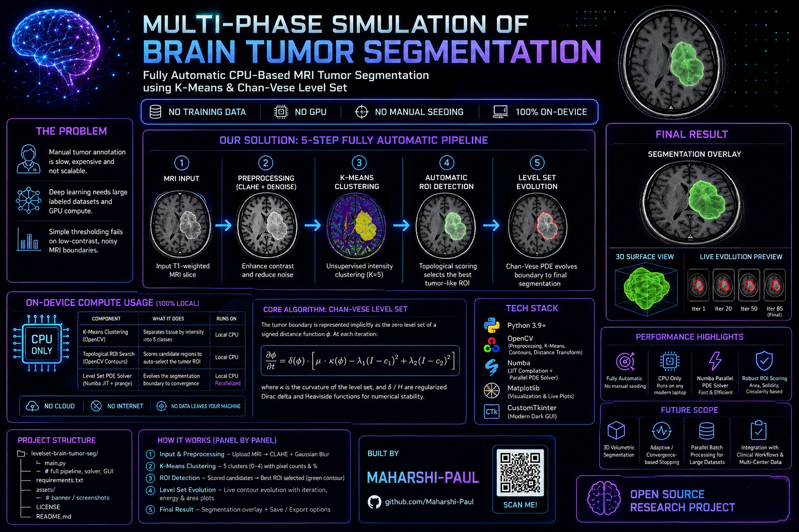

<p align="center">
  
</p>

# Level-Set Brain Tumor Segmentation

<p align="center">
  <a href="https://github.com/Maharshi-Paul/levelset-brain-tumor-seg/actions/workflows/ci.yml"></a>
  
  <a href="./LICENSE"></a>
  
</p>

**Fully automatic brain tumor segmentation from MRI: no manual seeding, no training data, no GPU.** Unsupervised K-Means clustering and a topological ROI search initialize a Numba-parallel Chan-Vese level-set solver. Watch it converge live in a CustomTkinter desktop dashboard, or run it headlessly from the command line (reproducible with `--seed`).

> [!WARNING]
> Research and educational use only. This is not a medical device and must not be used for diagnosis or treatment decisions. See [Clinical Disclaimer & Limitations](#clinical-disclaimer--limitations).

Built by [Maharshi-Paul](https://github.com/Maharshi-Paul) · Poster design by [DIPESHCHOUDHARY-CODES](https://github.com/DIPESHCHOUDHARY-CODES)

---

## Table of Contents

- [Quick Start](#quick-start)
- [Sample Outputs](#sample-outputs)
- [Problem](#problem)
- [Solution](#solution)
- [On-Device Compute Usage](#on-device-compute-usage)
- [Mathematical Formulation](#mathematical-formulation)
- [Project Architecture](#project-architecture)
- [Installation & Setup](#installation--setup)
- [Usage](#usage)
  - [Interactive GUI Dashboard](#interactive-gui-dashboard)
  - [Headless Command-Line Interface (CLI)](#headless-command-line-interface-cli)
  - [Mask Evaluation Tool](#mask-evaluation-tool-evaluatepy)
- [Configuration](#configuration)
- [How It Works, Panel by Panel](#how-it-works-panel-by-panel)
- [Running Tests & Linting](#running-tests--linting)
- [Benchmarks](#benchmarks)
- [Data Source & Attribution](#data-source--attribution)
- [Performance Optimizations](#performance-optimizations)
- [Clinical Disclaimer & Limitations](#clinical-disclaimer--limitations)
- [References](#references)
- [Citation](#citation)
- [License](#license)

---

## Quick Start

```bash
# 1. Clone the repository
git clone https://github.com/Maharshi-Paul/levelset-brain-tumor-seg.git
cd levelset-brain-tumor-seg

# 2. Install dependencies (a virtual environment is recommended; see Installation & Setup)
pip install -r requirements.txt

# 3. Launch the interactive GUI
python main.py
```

Prefer the command line? Segment a folder of images headlessly:

```bash
python -m levelset_seg -i data/ -o results/ --save-panels --json metrics.json
```

<!--
TODO: Once real screenshots and a recording are captured, restore a "Screenshots & Demo"
section (and its Table of Contents entry) with:

| Full Application Dashboard | Dynamic Contour Evolution |
|:---:|:---:|
|  |  |

- assets/dashboard.png: full 3-panel GUI view during or after segmentation
- assets/demo.gif: screen recording of contour convergence
-->

---

## Sample Outputs

Pre-generated results from the sample MRI slices in `data/` are included in [`sample_outputs/`](./sample_outputs), so you can see what the pipeline produces without installing anything. For each input image, the CLI writes:

- **Contour overlay:** the original slice with the final $\phi = 0$ tumor boundary drawn on top.
- **3-panel visualization** (with `--save-panels`): K-Means clusters, selected ROI with its convex hull, and the evolved level set. See [How It Works, Panel by Panel](#how-it-works-panel-by-panel).
- **Execution metrics** (with `--json`): ROI solidity, iteration count, and solve time. These are the same figures reported in [Benchmarks](#benchmarks).

To regenerate them locally:

```bash
python -m levelset_seg -i data/ -o sample_outputs/ --save-panels --json sample_outputs/metrics.json --seed 42
```

Using `--seed 42` makes the K-Means initialization deterministic, so your results should match the committed outputs closely.

---

## Problem

Brain tumor segmentation in magnetic resonance imaging (MRI) is traditionally approached in one of two ways:

1. **Manual tracing by a radiologist.** Accurate, but labor-intensive, subjective, and hard to scale across clinical workflows.
2. **Deep learning models.** Highly capable, but dependent on large pixel-annotated datasets and GPU infrastructure, and vulnerable to distribution shift across scanners, field strengths, and acquisition protocols.

Simple intensity thresholding breaks down on low-contrast, noisy tissue margins. Classical active-contour (snake) methods need an expert to place a seed point or bounding box inside the lesion before evolution can begin.

---

## Solution

`levelset-brain-tumor-seg` removes manual intervention entirely. It is an end-to-end, CPU-only pipeline (reproducible with `--seed`):

```
[MRI Slice] ──> [CLAHE & Blur] ──> [K-Means (k=5)] ──> [Topological ROI Scoring] ──> [Initial SDF φ₀] ──> [Chan-Vese PDE (Numba CPU)] ──> [Tumor Contour]
```

1. **Contrast enhancement and unsupervised clustering.** Contrast-Limited Adaptive Histogram Equalization (CLAHE) and mild Gaussian filtering enhance tissue contrast. OpenCV K-Means ($k=5$) then partitions intensities without supervision.

2. **Topological ROI discovery.** The brightest clusters are scanned for candidate contours, and each is scored on area, convexity (solidity), and circularity:

   $$\text{Score} = \sqrt{\text{Area}} \cdot \text{Solidity}^3 \cdot \text{Circularity}^3$$

   This isolates round, convex tumor masses without any seed points.

3. **Two-phase Chan-Vese level-set PDE.** The detected ROI initializes a signed distance function (SDF) $\phi_0$. The Chan-Vese energy functional then evolves it, using CPU-parallel finite differences, until it locks onto the tissue boundary.

> **Terminology.** The *software pipeline* has several stages (preprocessing → topological selection → PDE evolution). The *level-set solver* itself implements a **two-phase** Chan-Vese model, partitioning the domain into an interior ($\phi < 0$) and an exterior ($\phi > 0$).

---

## On-Device Compute Usage

**Everything runs locally on a standard consumer CPU. No cloud dependencies, no GPU.**

| Component | Operation | Engine |
|---|---|---|
| Image preprocessing | CLAHE, Gaussian blur, dimension scaling | OpenCV (`cv2`) |
| Unsupervised clustering | Intensity grouping into 5 clusters | OpenCV K-Means (CPU) |
| Topological search | Contour extraction, convex hull, shape scoring | OpenCV contours |
| SDF initialization | Exact Euclidean distance transform | OpenCV distance transform ($L_2$) |
| Level-set PDE solver | Curvature, Dirac/Heaviside updates, reductions | Numba JIT + `prange` CPU parallelism (`cache=True`) |

There is no network telemetry and no external API calls, and no patient data leaves the local machine.

---

## Mathematical Formulation

<details>
<summary><strong>Show the full derivation (click to expand)</strong></summary>

### Level-Set Representation and Sign Convention

The tumor boundary $C$ is represented implicitly as the zero level set of a Lipschitz-continuous signed distance function $\phi: \Omega \rightarrow \mathbb{R}$:

$$C = \{ \mathbf{x} \in \Omega \mid \phi(\mathbf{x}) = 0 \}$$

Following the solver implementation:

- **Tumor interior:** $\phi(\mathbf{x}) < 0$
- **Exterior / background:** $\phi(\mathbf{x}) > 0$
- **Interface / contour:** $\phi(\mathbf{x}) = 0$

### Regional Means

The regional means $c_1$ and $c_2$ are computed with continuous Heaviside weighting. $c_1$ is the average intensity of the **exterior** region ($\phi > 0$), weighted by the smoothed Heaviside step $H_\varepsilon(\phi)$:

$$c_1 = \frac{\int_\Omega I(\mathbf{x}) \, H_\varepsilon(\phi(\mathbf{x})) \, d\mathbf{x}}{\int_\Omega H_\varepsilon(\phi(\mathbf{x})) \, d\mathbf{x}}$$

$c_2$ is the average intensity of the **tumor interior** ($\phi < 0$), weighted by $1 - H_\varepsilon(\phi)$:

$$c_2 = \frac{\int_\Omega I(\mathbf{x}) \, \bigl(1 - H_\varepsilon(\phi(\mathbf{x}))\bigr) \, d\mathbf{x}}{\int_\Omega \bigl(1 - H_\varepsilon(\phi(\mathbf{x}))\bigr) \, d\mathbf{x}}$$

### Chan-Vese Energy Functional

The two-phase Chan-Vese functional (Chan & Vese, 2001) being minimized is:

$$F(c_1, c_2, \phi) = \mu \cdot \text{Length}(\phi = 0) + \lambda_1 \int_\Omega |I(\mathbf{x}) - c_1|^2 H_\varepsilon(\phi) \, d\mathbf{x} + \lambda_2 \int_\Omega |I(\mathbf{x}) - c_2|^2 (1 - H_\varepsilon(\phi)) \, d\mathbf{x}$$

where:

- $I(\mathbf{x}) \in [0, 1]$ is the normalized image intensity.
- $\mu$ controls boundary smoothness by penalizing contour length.
- $\lambda_1, \lambda_2$ weight the exterior and interior data-fidelity terms.

### Euler-Lagrange Evolution PDE

Gradient descent on $F$ with respect to $\phi$ gives the evolution equation implemented in `compute_pde_step`:

$$\frac{\partial \phi}{\partial t} = \delta_\varepsilon(\phi) \left[ \mu \cdot \kappa(\phi) - \lambda_1 (I - c_1)^2 + \lambda_2 (I - c_2)^2 \right]$$

where $\kappa(\phi) = \text{div}\left(\frac{\nabla \phi}{|\nabla \phi|}\right)$ is the mean curvature, computed with central finite differences:

$$\kappa = \frac{\phi_{xx} \phi_y^2 - 2 \phi_x \phi_y \phi_{xy} + \phi_{yy} \phi_x^2}{(\phi_x^2 + \phi_y^2 + \eta)^{3/2}}$$

Here $\eta = 10^{-10}$ is a regularization constant that prevents division by zero in flat regions where $|\nabla \phi| \approx 0$.

### Regularized Heaviside and Dirac Delta

To keep numerical differentiation smooth across the interface, $H(\phi)$ and $\delta(\phi)$ are regularized with parameter $\varepsilon = 1.0$:

$$H_\varepsilon(\phi) = \frac{1}{2} \left( 1 + \frac{2}{\pi} \arctan\left(\frac{\phi}{\varepsilon}\right) \right)$$

$$\delta_\varepsilon(\phi) = \frac{\varepsilon / \pi}{\varepsilon^2 + \phi^2}$$

</details>

---

## Project Architecture

```
levelset-brain-tumor-seg/
├── levelset_seg/                  # Core package
│   ├── __init__.py                # Package export & version metadata
│   ├── __main__.py                # CLI entry point (python -m levelset_seg)
│   ├── cli.py                     # Headless CLI (batch, panels, JSON)
│   ├── config.py                  # SolverConfig dataclass (single source of truth)
│   ├── evaluate.py                # Dice and IoU evaluation functions
│   ├── gui.py                     # CustomTkinter + Matplotlib dashboard
│   ├── preprocessing.py           # CLAHE, Gaussian blur, scaling, K-Means
│   ├── roi.py                     # Topological contour scoring & SDF creation
│   └── solver.py                  # Numba-parallelized Chan-Vese PDE solver (cache=True)
├── tests/                         # Pytest test suite
│   ├── __init__.py
│   ├── test_cli.py                # Headless CLI & batch tests
│   ├── test_evaluate.py           # Dice & IoU unit tests on synthetic masks
│   ├── test_preprocessing.py      # CLAHE & K-Means unit tests
│   ├── test_roi.py                # Shape scoring & SDF clamp tests
│   └── test_solver.py             # Math invariants (Heaviside/Dirac) & synthetic IoU
├── .github/
│   └── workflows/
│       └── ci.yml                 # GitHub Actions CI matrix (Python 3.10–3.14)
├── assets/                        # Visual banners & UI assets
│   └── levelset_banner.png
├── data/                          # Sample brain MRI slices (meningioma)
├── evaluate.py                    # Standalone evaluation CLI
├── main.py                        # Thin application launcher
├── pyproject.toml                 # Ruff linting & pytest configuration
├── requirements.txt               # Pinned core production dependencies
├── requirements-dev.txt           # Testing & linting tools
├── CITATION.cff                   # Citation metadata
├── .gitignore
├── LICENSE                        # MIT License
└── README.md
```

---

## Installation & Setup

### Prerequisites

- Python 3.10 to 3.14 (tested on 3.10, 3.11, 3.12, 3.13, and 3.14.3)
- Windows, macOS, or Linux

### 1. Clone the Repository

```bash
git clone https://github.com/Maharshi-Paul/levelset-brain-tumor-seg.git
cd levelset-brain-tumor-seg
```

### 2. Create and Activate a Virtual Environment

**Windows (PowerShell):**

```powershell
python -m venv venv
.\venv\Scripts\Activate.ps1
```

**Windows (Command Prompt):**

```cmd
python -m venv venv
venv\Scripts\activate.bat
```

**macOS / Linux:**

```bash
python3 -m venv venv
source venv/bin/activate
```

> **Linux / macOS GUI users:** the desktop interface needs system Tkinter bindings.
> - **Ubuntu / Debian:** `sudo apt-get install python3-tk`
> - **macOS (Homebrew):** `brew install python-tk`

### 3. Install Dependencies

```bash
pip install --upgrade pip
pip install -r requirements.txt
```

For development and testing tools:

```bash
pip install -r requirements-dev.txt
```

> **Numba compilation:** JIT functions use `cache=True`. Compilation happens on the first call and is cached on disk, so later runs start at near-native speed.

---

## Usage

### Interactive GUI Dashboard

```bash
python main.py
```

1. Click **Upload Batch & Segment** and choose one or more MRI images from `data/` or your own files (`.png`, `.jpg`, `.jpeg`, `.tif`, `.bmp`).
2. Watch the three-panel display update as the contour evolves (see [How It Works, Panel by Panel](#how-it-works-panel-by-panel)).
3. Use **Prev** and **Next** to step through the segmented images in the batch.

### Headless Command-Line Interface (CLI)

For batch processing, scripting, or headless servers (no Tkinter/X11 needed):

```bash
# Segment a single image
python -m levelset_seg --input data/Te-me_0015.jpg --output output_overlay.png

# Batch-process an entire directory
python -m levelset_seg --input data/ --output results/

# Full batch run: 3-panel visualizations, metrics JSON, fixed RNG seed
python -m levelset_seg -i data/ -o results/ --save-panels --json results/metrics.json --seed 42

# Stop early once the contour has converged
python -m levelset_seg -i data/Te-me_0015.jpg -o result.png --convergence-tol 0.005
```

| Option | Description |
|---|---|
| `-i`, `--input` | **Required.** Path to an input image or a directory of images. |
| `-o`, `--output` | **Required.** Output overlay PNG path, or an output directory when `--input` is a directory. |
| `--iterations` | Number of PDE iterations (default: 85). |
| `--convergence-tol` | Stop early when $\max\lvert\phi_{t+1} - \phi_t\rvert < \text{tol}$. |
| `--seed` | OpenCV random seed for reproducible K-Means initialization. |
| `--save-panels` | Also save the side-by-side 3-panel visualization (K-Means, ROI, level set). |
| `--json [FILE]` | Write execution metrics as JSON to `FILE`, or print to stdout if no path is given. |

### Mask Evaluation Tool (`evaluate.py`)

Compute the Dice Similarity Coefficient (DSC) and Intersection over Union (IoU / Jaccard index) between a predicted binary mask and a ground-truth annotation:

```bash
# Print metrics to stdout
python evaluate.py --pred path/to/pred_mask.png --gt path/to/gt_mask.png

# Output as JSON
python evaluate.py --pred path/to/pred_mask.png --gt path/to/gt_mask.png --json
```

---

## Configuration

All solver defaults live in the `SolverConfig` dataclass (`levelset_seg/config.py`):

| Parameter | Default | Description |
|---|---|---|
| `total_iterations` | `85` | Fixed number of evolution steps (when convergence stopping is inactive) |
| `dt` | `0.5` | Euler integration time step |
| `lambda1`, `lambda2` | `1.0`, `1.0` | Exterior and interior data-fidelity weights |
| `mu` | Adaptive (`0.25` or `0.5`) | Curvature weight: `0.25` if $\text{Var}(I) \ge 0.05$ (textured/noisy), otherwise `0.5` (smooth) |
| `variance_threshold` | `0.05` | Variance cutoff that selects the adaptive $\mu$ |
| `epsilon` | `1.0` | Heaviside / Dirac regularization width |
| `max_dim` | `400` | Maximum spatial dimension for aspect-preserving scaling |
| `kmeans_k` | `5` | Number of intensity clusters |
| `phi_clip` | `5.0` | Symmetric signed-distance clamp, $[-5.0, +5.0]$ |
| `convergence_tol` | `None` | Optional early-stopping tolerance: $\max\lvert\phi_{t+1} - \phi_t\rvert < \text{tol}$ |

---

## How It Works, Panel by Panel

| Panel | Method | Visual Output |
|---|---|---|
| **1. Unsupervised Clusters** | $k$-Means clustering in CLAHE intensity space | Color-coded partition of pixel intensities into 5 clusters. |
| **2. Convex Hull ROI** | Morphological filtering + contour scoring ($\sqrt{A} \cdot S^3 \cdot C^3$) | Selected tumor candidate filled in cyan with its convex hull in green, plus a live solidity readout. |
| **3. Level Set Evolution** | Chan-Vese PDE solved with explicit Euler finite differences | The original MRI slice overlaid with the evolving $\phi = 0$ contour (neon green), updated in real time until it converges. |

---

## Running Tests & Linting

```bash
pytest -v        # run the test suite
ruff check .     # lint
```

The test suite covers:

- Invariants of the regularized Heaviside and Dirac delta ($H(0) = 0.5$, $\delta(0) = 1/\pi$, asymptotic limits, monotonicity, symmetry).
- A synthetic disc segmentation integration test asserting contour recovery ($\text{IoU} \ge 0.7$).
- Image scaling, aspect-ratio preservation, CLAHE contrast bounds, and K-Means clustering.
- Topological shape scoring, distance-transform sign convention, and SDF clipping.
- Dice and IoU on identical, disjoint, and partially overlapping masks.
- End-to-end headless CLI workflows (single file, directory batch, `--save-panels`, `--json`).

---

## Benchmarks

Runtimes and ROI metrics recorded on the sample images in `data/`:

| Image ID | Dimensions | ROI Solidity | Iterations | Solve Time (s) |
|---|---|---|---|---|
| `Te-me_0015.jpg` | 400 × 335 | 0.9866 | 85 | 1.182 *(includes first-call JIT compilation)* |
| `Te-me_0020.jpg` | 306 × 306 | 0.9177 | 85 | 0.125 |
| `Te-me_0223.jpg` | 400 × 400 | 0.8901 | 85 | 0.139 |
| `Tr-me_0019.jpg` | 400 × 400 | 0.9176 | 85 | 0.113 |
| `Tr-me_0037.jpg` | 400 × 400 | 0.8953 | 85 | 0.109 |
| `Tr-me_0083.jpg` | 400 × 400 | 0.8951 | 85 | 0.133 |
| `Tr-me_0089.jpg` | 400 × 400 | 0.9190 | 85 | 0.126 |
| `Tr-me_0108.jpg` | 400 × 400 | 0.9827 | 85 | 0.160 |
| `Tr-me_0177.jpg` | 270 × 250 | 0.9723 | 85 | 0.067 |
| `Tr-me_0594.jpg` | 320 × 257 | 0.9528 | 85 | 0.084 |

**Provenance**

- **Platform:** Windows 11, x86_64
- **Software:** Python 3.14.3, Numba 0.65.1 (`cache=True`), NumPy 2.4.4, OpenCV 4.13.0
- **Command:** `python -m levelset_seg -i data/ -o bench/ --json --seed 42`
- **Timing:** The first slice includes one-time LLVM JIT compilation (~1.18 s). Steady-state solves take about 0.07–0.16 s per image (mean ≈ 0.12 s over the remaining nine).
- **Accuracy:** Pixel-level Dice and IoU need ground-truth masks, which are not bundled. Use [`evaluate.py`](./evaluate.py) to compute them once annotated masks are available.

---

## Data Source & Attribution

The sample images in `data/` follow the `Te-me_*` / `Tr-me_*` naming convention of the [Brain Tumor MRI Dataset on Kaggle](https://www.kaggle.com/datasets/masoudnickparvar/brain-tumor-mri-dataset), curated by Masoud Nickparvar. That dataset aggregates scans from three sources:

1. **Figshare Brain Tumor Dataset** (Jun Cheng et al.)
2. **SARTAJ Dataset**
3. **Br35H Dataset**

- **Class:** Meningioma (`me`) brain MRI slices.
- **License:** See the [Kaggle dataset page](https://www.kaggle.com/datasets/masoudnickparvar/brain-tumor-mri-dataset). <!-- TODO: Confirm specific upstream image license terms -->

---

## Performance Optimizations

1. **Numba JIT with `parallel=True` and `cache=True`.** The PDE update core (`compute_pde_step`) compiles to native code via LLVM, with the compiled result cached on disk. Both the spatial reductions (the regional averages $c_1$, $c_2$) and the central finite-difference curvature updates use multi-core scheduling through `prange`.
2. **Adaptive curvature regularization.** The curvature weight $\mu$ adapts to image variance: $\mu = 0.25$ for textured or noisy images (variance $\ge 0.05$) and $\mu = 0.5$ for homogeneous slices, which avoids over-smoothing delicate boundaries.
3. **Bounded, aspect-preserving scaling.** Images larger than 400 px in either dimension are scaled down with their aspect ratio intact, capping the finite-difference grid at 160,000 points.
4. **Non-blocking GUI.** The simulation runs in a background worker thread (`threading.Thread`) and streams state updates to the UI by polling, so the window never freezes.

---

## Clinical Disclaimer & Limitations

> [!WARNING]
> **RESEARCH AND EDUCATIONAL USE ONLY.**
> This software is a prototype built for academic and educational demonstration. It has **not** been certified, cleared, or validated by the FDA, EMA, or any other regulatory authority, and it must **not** be used for clinical diagnosis, treatment planning, or medical decision-making.

### Known Technical Limitations

- **2D slices only.** The pipeline works on single 2D slices and does not reconstruct volumes across a z-stack.
- **Two-phase model.** Standard two-phase Chan-Vese assumes one foreground and one background class. Heterogeneous tumors with distinct components (for example, a glioblastoma with a necrotic core and surrounding edema) need multi-phase level-set formulations.
- **Geometric prior.** ROI selection ($\sqrt{\text{Area}} \cdot \text{Solidity}^3 \cdot \text{Circularity}^3$) favors round, convex regions. That suits meningiomas but may struggle with irregular, infiltrative, or multi-focal pathologies.
- **Sample data.** The images bundled in `data/` are meningioma cases only.

---

## References

- T. F. Chan and L. A. Vese, "Active contours without edges," *IEEE Transactions on Image Processing*, vol. 10, no. 2, pp. 266–277, Feb. 2001. doi: [10.1109/83.902291](https://doi.org/10.1109/83.902291).

---

## Citation

If you use this repository in academic or research work, please cite it using the metadata in [`CITATION.cff`](./CITATION.cff):

```bibtex
@software{Paul_levelset_brain_tumor_seg_2026,
  author = {Paul, Maharshi},
  title = {{levelset-brain-tumor-seg: Fully Automatic Level-Set Brain Tumor Segmentation}},
  url = {https://github.com/Maharshi-Paul/levelset-brain-tumor-seg},
  version = {0.1.0},
  year = {2026}
}
```

---

## License

This project is licensed under the MIT License. See the [LICENSE](./LICENSE) file for details.